<picture>
  <source media="(prefers-color-scheme: dark)" srcset="assets/profile-dark.svg">
  <source media="(prefers-color-scheme: light)" srcset="assets/profile-light.svg">
  
</picture>

# Hi, I'm Daniel.

**Software & AI Engineer · Cloud infrastructure · Distributed systems**

I build software, automate the infrastructure behind it, and work through the failures that sit between the two. My background spans financial systems, Kubernetes platforms and practical AI applications.

**[Explore my portfolio ↗](https://portfolio.danielboakye.info/)** &nbsp; / &nbsp; **[Connect on LinkedIn ↗](https://www.linkedin.com/in/danielnb/)** &nbsp; / &nbsp; **[Email me ↗](mailto:daniel.nti.boakye@gmail.com)**

Open to Software, AI Platform, Platform Engineering and SRE opportunities.

---

### Experience, at a glance

- **Financial systems:** contingent software engineering at Morgan Stanley through Turntabl, supporting the data access layer of a risk calculation engine.
- **Cloud & reliability:** Kubernetes upgrade automation, deployment tooling, monitoring and distributed execution across Azure and AWS environments.
- **AI & business:** MSc Artificial Intelligence with Business Strategy, Aston University. I care about where AI is useful and what it takes to run it reliably.
- **Teaching & leadership:** mentoring engineers and teaching Python, Java and AI fundamentals. Making a difficult system understandable is part of the work.

### Explore my work

Three ways into the problems I enjoy solving. These are public projects and learning resources you can inspect.

#### 01 / Applied AI

**[Personal AI Chatbot ↗](https://github.com/D-artisan/ai-chatbot)**  
A privacy-focused chatbot with document Q&A, local or remote model inference, persistent chat history and optional voice interaction.

`Python` `LangChain` `Ollama` `FAISS` `Streamlit`

<strong>Explore the engineering</strong>

- PDF and text retrieval with vector embeddings.
- Separate configuration for chat and embedding models.
- Both a Streamlit interface and a terminal workflow.
- Graceful handling when optional audio dependencies are unavailable.

[Read the setup and explore the code →](https://github.com/D-artisan/ai-chatbot#readme)

#### 02 / Distributed systems & reliability

**[HotelStream Reliability Lab ↗](https://github.com/D-artisan/trivago-sre-lab)**  
A hands-on Kubernetes and Kafka learning lab for exploring event processing, consumer lag, autoscaling and recovery from failure.

`Kubernetes` `Kafka` `KEDA` `Redis` `Python`

<strong>Explore the failure scenarios</strong>

- Consumer groups, partitions and the limits of parallelism.
- Scaling consumers with KEDA based on Kafka lag.
- Broker and consumer failures, rebalancing and event replay.
- A Redis read model fed by hotel-price events.

This is an independent learning lab inspired by trivago's published engineering work.

[Explore the lab and learning checkpoints →](https://github.com/D-artisan/trivago-sre-lab#readme)

#### 03 / Observability & developer education

**[Observability Platform Guide ↗](https://github.com/D-artisan/observability-platform)**  
A practical guide to instrumenting Python microservices and connecting their metrics, logs and traces through an OpenTelemetry Collector.

`OpenTelemetry` `Grafana` `Loki` `Tempo` `Mimir`

<strong>Explore the architecture</strong>

- A payment-transfer example with pricing and notification services.
- Centralised telemetry collection and routing.
- Dashboards, alerts and the relationships between signals.
- Docker and local Kubernetes deployment walkthroughs.

[Read the architecture and implementation guide →](https://github.com/D-artisan/observability-platform#readme)

---

### Tools I work with

| Area | Core tools |
| :--- | :--- |
| Software | Python, Java, Scala, SQL, Spring Boot, Django |
| AI applications | LangChain, Ollama, FAISS, scikit-learn |
| Cloud & delivery | AWS, Azure, Kubernetes, Docker, Terraform, Helm |
| Data & operations | PostgreSQL, MongoDB, Redis, Kafka, Grafana, Splunk |

<strong>More of my toolkit</strong>

**Languages & interfaces:** JavaScript, Kotlin, Go, React, Angular, Flutter.  
**Automation & delivery:** Bash, Linux, Ansible, Jenkins, CircleCI, CloudFormation.  
**Data & integration:** Prometheus, ZooKeeper, Apache Camel, jOOQ, Quartz.  
**AI & analysis:** NumPy, pandas, Jupyter, document retrieval and speech interfaces.

### Let's build something useful.

If your team needs someone who can connect application code, cloud infrastructure and AI, I'd like to hear what you're working on.

**[Start a conversation →](mailto:daniel.nti.boakye@gmail.com)** &nbsp; · &nbsp; [See more of my work](https://portfolio.danielboakye.info/)

Daniel Nti-Boakye · Diary of a problem solver.
